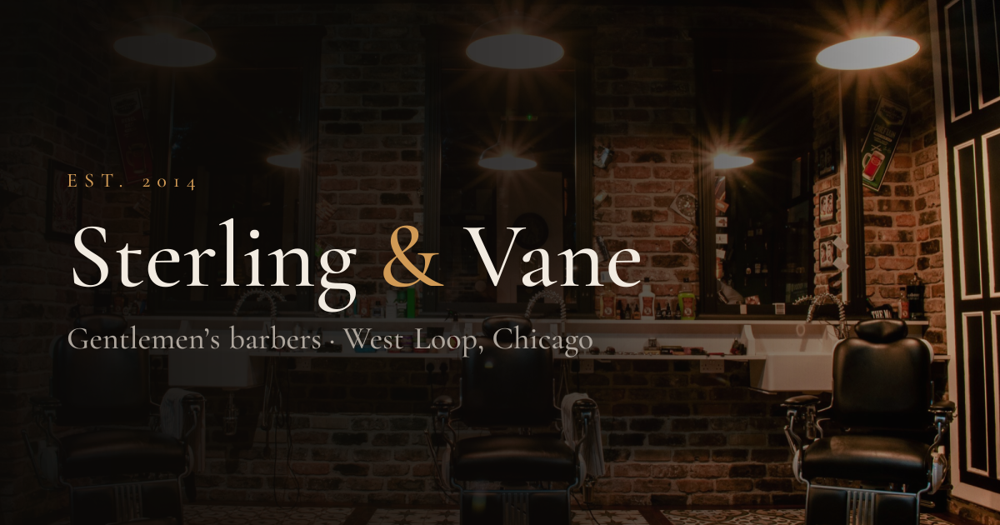

# Sterling & Vane



A premium barbershop website for a fictional shop in Chicago's West Loop, with a multi-step booking flow and an AI concierge that recommends services and barbers from the shop's own data.

**Live site:** https://sterling-vane-lyart.vercel.app

> Concept project for my portfolio. The shop, barbers, reviews and contact details are fictional.

## Highlights

- **Booking wizard:** service → barber → date & time → details, with a live summary. One Zod schema validates in the browser and again in a Server Action. Bookings are emailed to the shop with Resend.
- **Shop time zone:** availability is calculated in Chicago time on both client and server, so past slots are hidden and rejected wherever the visitor or server is.
- **AI concierge:** streaming chat (Vercel AI SDK + AI Gateway, Gemini Flash) grounded in the services, barbers and hours data. Recommendations become buttons that open the booking form pre-filled.
- **Secured AI endpoint:** API key server-side only, message role/length/count validation, capped output, and Upstash Redis rate limiting (per visitor and site-wide, separated per environment). Fails closed in production.
- **Deep links:** `/book?service=…` and `/book?barber=…` pre-select the wizard; unknown values are ignored.
- **SEO:** title template, canonical URLs, generated Open Graph image, and validated `HairSalon` structured data built from the same hours as the booking calendar.
- **Accessible:** keyboard and screen-reader friendly wizard and chat, WCAG AA contrast, reduced-motion safe, responsive from 320px.

## Lighthouse (mobile, PageSpeed Insights)

| Page | Performance | Accessibility | Best Practices | SEO |
| ---- | :---------: | :-----------: | :------------: | :-: |
| Home |     98      |      100      |      100       | 100 |
| Book |     100     |      100      |      100       | 100 |

## Tech stack

Next.js 16 (App Router, Server Components, Server Actions, Cache Components) · React 19 · TypeScript · Tailwind CSS v4 · React Hook Form + Zod · Vercel AI SDK + AI Gateway · Upstash Redis · Resend · Vitest · GitHub Actions · Vercel

## Getting started

```bash
git clone https://github.com/dev-rome/Sterling-Vane.git
cd sterling-and-vane
npm install
cp .env.example .env.local   # then fill in the values you have
npm run dev
```

Open http://localhost:3000.

Everything works without keys except the concierge: bookings fall back to a logged demo mode, and rate limiting is skipped in development.

### Environment variables

| Variable                               | Used for                                                                                    |
| -------------------------------------- | ------------------------------------------------------------------------------------------- |
| `RESEND_API_KEY`                       | Sending booking emails                                                                      |
| `BOOKING_INBOX`                        | Where booking emails go (with Resend's test sender, this must be your Resend account email) |
| `AI_GATEWAY_API_KEY`                   | AI concierge (Vercel AI Gateway)                                                            |
| `KV_REST_API_URL`, `KV_REST_API_TOKEN` | Rate limiting (Upstash Redis)                                                               |

## Scripts

| Command          | What it does                                                 |
| ---------------- | ------------------------------------------------------------ |
| `npm run dev`    | Start the dev server                                         |
| `npm run build`  | Production build                                             |
| `npm test`       | Run unit tests once (`npm run test:watch` to re-run on save) |
| `npm run lint`   | ESLint                                                       |
| `npm run format` | Format with Prettier (`format:check` to verify)              |

CI runs lint, format check and tests on every pull request.

## Project structure

```
src/
  app/                 Routes, metadata, Open Graph image
    api/concierge/     AI chat endpoint
    book/              Booking page + Server Action
  components/          Page sections, ConciergeChat
    booking/           Wizard, steps, summary
  data/                Services, barbers, products, shop details
  lib/                 Schedule, shop time, schema, prompt, rate limit
```

## Workflow

Feature branches → pull request (CI + Vercel preview) → squash merge to `main` → production deploy. Commits follow [Conventional Commits](https://www.conventionalcommits.org).

## Credits

- **Photography:** [Fabio Alves](https://unsplash.com/photos/DYetcnz0jRY) and [Tony Flood](https://unsplash.com/photos/kN9m5qAZx3M) on Unsplash; product photos from Magnific; hero photo: _TODO_.
- **Barber portraits** are AI-generated images from StockCake (fictional people).
- **Fonts:** Cormorant Garamond and Jost via Google Fonts (SIL Open Font License).
