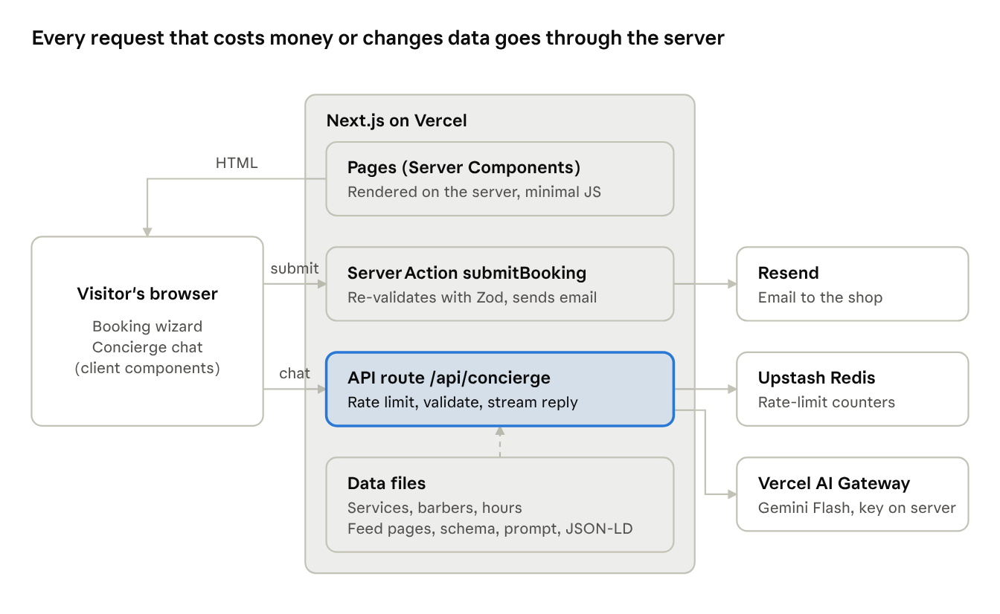

# Sterling & Vane — Case Study

Nov 27, 2026 · Jerome Haynes

## Overview

Sterling & Vane is a premium barbershop website I designed and built solo: a marketing site, a four-step booking wizard and an AI concierge, live on Vercel with Lighthouse scores of 98–100 on mobile.

- **Live site:** [sterling-vane-lyart.vercel.app](https://sterling-vane-lyart.vercel.app)
- **Code:** [github.com/dev-rome/Sterling-Vane](https://github.com/dev-rome/Sterling-Vane)
- **Role:** design, front end, back end, deployment, testing
- **Stack:** Next.js 16 (App Router, Server Components, Server Actions), React 19, TypeScript, Tailwind CSS v4, React Hook Form + Zod, Vercel AI SDK + AI Gateway, Upstash Redis, Resend, Vitest, GitHub Actions

The shop is fictional (a concept project), but the site works end to end: bookings arrive by email, and the concierge answers from the shop's real data.

**30-second pitch:** "I built a barbershop site to show I can ship a complete product, not just pages. Visitors can book through a validated four-step wizard that emails the shop, or ask an AI concierge that recommends a service and barber and drops them into the booking form pre-filled. The AI endpoint keeps its key on the server, validates every message and is rate-limited with Redis. It scores 98 to 100 on Lighthouse, has unit tests running in CI, and every change went through a pull request with a preview deploy."

## Goals and constraints

The goal was a portfolio piece that holds up to a client or an interviewer clicking through it: premium look, real features, production habits.

| Goal                           | What it meant in practice                                                                                                 |
| ------------------------------ | ------------------------------------------------------------------------------------------------------------------------- |
| Premium feel                   | Warm, dark "heritage" design: Cormorant Garamond + Jost, espresso and amber palette, subtle reduced-motion-safe animation |
| Mobile first                   | Built from 320px up, 44px touch targets, no sideways scrolling at any size                                                |
| Accessible                     | WCAG AA contrast, keyboard and screen-reader support in the wizard and chat                                               |
| Fast                           | Lighthouse 90+ on mobile; optimised images with `next/image`                                                              |
| Findable                       | Titles, descriptions, canonical URLs, Open Graph image, structured data                                                   |
| A real AI feature, done safely | Key never in the browser, validated input, rate limits, a spending budget                                                 |
| Low cost                       | Free tiers wherever possible (Vercel, Upstash, Resend); about $5 of AI credits                                            |
| Honest                         | Fictional shop clearly labelled; sample reviews marked; every photo credited                                              |

## Key decisions

Most decisions came down to one rule: never trust the browser, and keep one source of truth for each fact.

1. **Server Components by default, client only where needed.** The page sections render on the server; only the wizard, chat and mobile menu use `"use client"`. Less JavaScript ships, which helps the 98–100 performance score.
2. **One Zod schema, checked twice.** The same booking schema validates in the browser (instant errors) and again in the Server Action. The server never trusts what the form sends.
3. **The shop's time zone, not the visitor's.** Availability is calculated in `America/Chicago` on both client and server, so a visitor in another time zone, or a server running in UTC, can't book a slot that has already passed.
4. **Data files as the single source of truth.** Services, barbers and hours live in `src/data` and `lib/schedule.ts`. The booking calendar, the AI prompt and the Google structured data all read from them, so they can never disagree.
5. **A grounded AI, not a general chatbot.** The concierge's system prompt is built from that data, limited to shop topics, and told it can't book or see availability. Its booking links are matched against real slugs before they become buttons.
6. **AI behind my own route.** The browser only talks to `/api/concierge`; the AI Gateway key stays in server env vars. The route rejects injected `system` messages, long inputs and long conversations, caps output, and retries once.
7. **Rate limiting that fails closed.** Upstash Redis limits each visitor (10/minute, 40/day) and the whole site (500/day). If Redis is missing or down in production, the concierge pauses instead of allowing unlimited paid calls.
8. **A small, fast model.** Gemini Flash through the AI Gateway: about $0.0013 per reply, around 2 seconds. Switching models is one line.
9. **A production-style workflow.** Every change: feature branch, pull request, CI (lint, format, tests), Vercel preview, squash merge, automatic deploy. Commits follow Conventional Commits.

The browser never talks to Resend, Redis or the AI provider directly; the Server Action and the API route hold the keys and run every check first.

## Challenges and how I solved them

The most useful lessons came from bugs that only showed up on the deployed site or under real conditions.

| Problem                                                           | Cause                                                                                                       | Fix                                                                       | Lesson                                                      |
| ----------------------------------------------------------------- | ----------------------------------------------------------------------------------------------------------- | ------------------------------------------------------------------------- | ----------------------------------------------------------- |
| Booking emails worked locally but not on the preview deploy       | Env vars were scoped to Production only, so previews ran in demo mode. Found it in the Vercel runtime logs. | Added Preview scope and redeployed (env changes only apply to new builds) | Env vars are per environment; read the logs before guessing |
| Clicking a second booking link showed the first link's choices    | Next.js keeps page state between navigations; state initialised from URL params went stale                  | Keyed the wizard on the search params so React remounts it per link       | Reset state from props with a `key`, not an effect          |
| Past time slots could be booked                                   | Dates were compared in the visitor's or server's time zone                                                  | Shop-time helpers in `America/Chicago`, used by UI and server             | Pick one clock for the business and test it                 |
| The AI returned nothing                                           | The free model spent its whole token budget "thinking"                                                      | Turned reasoning off and hid reasoning parts from the client              | Read the raw stream, not just the UI                        |
| The AI stated wrong facts (Sunday hours, what a service includes) | A small free model summarising loosely                                                                      | Stated key facts outright in the prompt; moved to Gemini Flash            | Test prompts like code; model choice matters for accuracy   |
| Rate-limit test never hit 429                                     | The AI provider's own limit and retries slowed requests past the 1-minute window                            | Tested with invalid requests (limit runs first, no AI call)               | Make tests fast and isolated                                |
| Local testing used up production's daily cap                      | Local, preview and production shared one Redis database                                                     | Prefixed keys with `VERCEL_ENV`                                           | Namespace shared infrastructure                             |
| Google showed no rich results                                     | I used `BarberShop`, which isn't a schema.org type                                                          | Switched to `HairSalon`; validated with schema.org and Google tools       | Validate structured data instead of trusting it             |
| Accessibility scored 93                                           | `role="log"` on an `ol` broke list semantics; muted grey text; a colour-only link                           | Wrapped the list, raised contrast, underlined inline links                | Lighthouse catches real WCAG issues                         |
| Product photos totalled ~82 MB                                    | Full-resolution originals committed to the repo                                                             | Resized to 1600px (~1.2 MB total, 98% smaller)                            | Optimised delivery doesn't excuse huge sources              |
| `npm install vitest` failed                                       | Peer dependency: Vitest needed newer `@types/node`                                                          | Upgraded `@types/node` to match the deploy runtime, no `--force`          | Fix the mismatch, don't silence it                          |

## Results

The live site scores 98–100 in every Lighthouse category on mobile, with 100 for accessibility on both pages.

| Page (mobile, PageSpeed Insights) | Performance | Accessibility | Best Practices | SEO |
| --------------------------------- | ----------- | ------------- | -------------- | --- |
| Home                              | 98          | 100           | 100            | 100 |
| Book                              | 100         | 100           | 100            | 100 |

- **Speed:** Largest Contentful Paint 0.9 s, Cumulative Layout Shift 0, Total Blocking Time 0–20 ms.
- **Tests:** 20 unit tests (schedule, Chicago time, booking validation with a frozen clock), run by GitHub Actions on every pull request and push to `main`, alongside lint and a format check.
- **Security:** server-only keys, double validation of bookings, AI input checks, three-layer rate limiting that fails closed.
- **Cost control:** free tiers for hosting, Redis and email; an AI Gateway budget cap; about $0.0013 per concierge reply.
- **SEO:** structured data passes the schema.org validator with 0 errors and Google's Rich Results Test with 2 valid items (local business, organization).
- **Accessibility fixes:** accessibility went from 93 to 100 on both pages after the fixes in the table above.

## What I'd do next

The biggest gap is that bookings are requests by email, not confirmed appointments; a real client version would start there.

1. **Real availability:** a database (for example Postgres) of appointments and barber schedules, so booked slots disappear and double-bookings are impossible.
2. **Confirmation emails** to the customer from a verified domain, with cancel and reschedule links.
3. **A simple admin view** for the shop to see and manage the day's bookings.
4. **Concierge with live data:** let the AI check real openings through a tool call, instead of only pointing to the booking page.
5. **End-to-end tests** (Playwright + axe) for the full booking and chat flows in a real browser.
6. **Analytics** (Vercel Analytics) to measure visits, booking completion and concierge use.
7. **Payments or deposits** for no-show protection, if a client wanted them.
